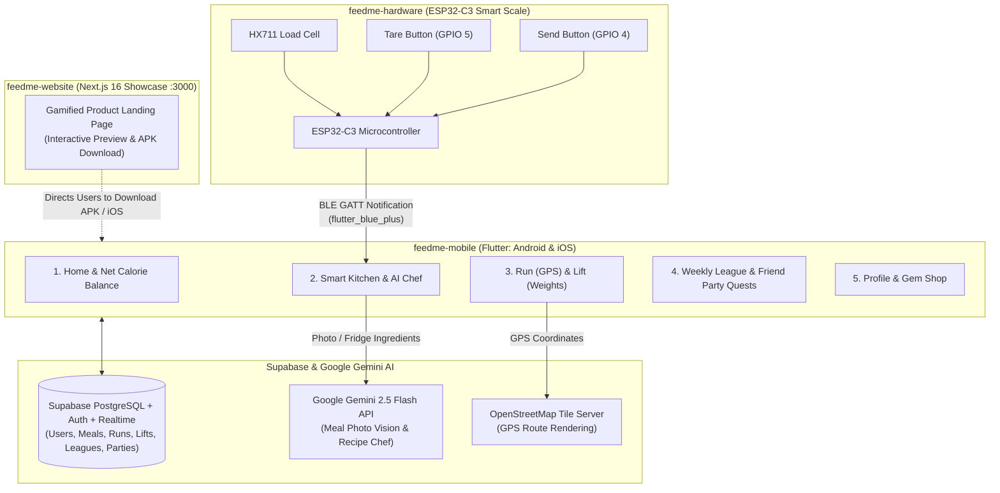
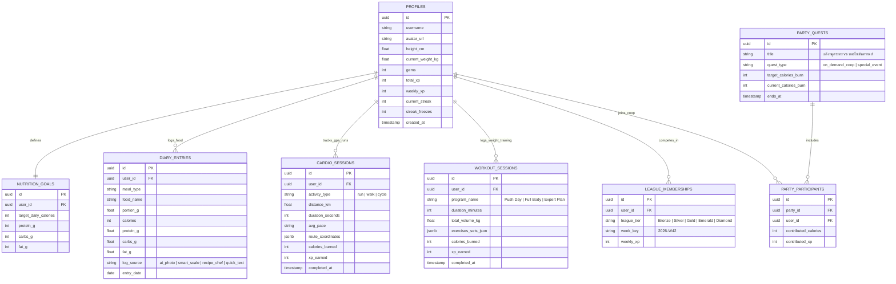

# 🏗️ FeedMe 2.0 — System Architecture & Data Flow

This document defines the architecture, hardware-to-mobile communication protocols, database schema, and AI pipelines for **FeedMe 2.0** across its three core pillars: **`feedme-mobile` (Flutter)**, **`feedme-website` (Next.js 16 Promo Site)**, and **`feedme-hardware` (ESP32-C3 Smart Scale)**.

---

## 1. High-Level System Topology



---

## 2. IoT Smart Scale BLE Protocol (`feedme-hardware` $\leftrightarrow$ `feedme-mobile`)

The Flutter app connects directly to the ESP32-C3 kitchen scale via Bluetooth Low Energy (`flutter_blue_plus`), eliminating manual gram entry when cooking at home.

- **Advertised Device Name:** `FeedMe Scale`
- **Primary Service UUID:** `4fafc201-1fb5-459e-8fcc-c5c9c331914b`
- **Weight Characteristic UUID:** `beb5483e-36e1-4688-b7f5-ea07361b26a8`
- **Properties:** `READ`, `NOTIFY`
- **Payload Structure (UTF-8 JSON):**
```json
{
  "weight": 185.5,
  "unit": "g",
  "stable": true
}
```
- **Hardware Pinout (ESP32-C3):**
  - `HX711 DOUT`: GPIO 19
  - `HX711 SCK`: GPIO 18
  - `TARE Button`: GPIO 5 (Zeroes out bowl/plate weight)
  - `SEND Button`: GPIO 4 (Locks current ingredient weight into the Flutter cooking bowl)

---

## 3. Database Entity Relationship Diagram (Supabase PostgreSQL)



---

## 4. Core Calculation & AI Pipelines

### 1. Real-Time Net Calorie Balance Engine
Every meal logged and every workout completed updates the daily equation on the Home tab:
$$\text{Net Calories} = \sum \text{Calories Consumed} - \left(\sum \text{Cardio Burned} + \sum \text{Weight Training Burned}\right)$$
$$\text{Remaining Calorie Quota} = \text{Target Daily TDEE} - \text{Net Calories}$$

### 2. Multimodal AI Food Scanner & "What Should I Cook?" Chef
- **Meal Photo Analysis:** Flutter captures/compresses the food image and sends it to `gemini-2.5-flash` with a structured JSON schema request, returning `dish_name`, `estimated_grams`, `calories`, `protein_g`, `carbs_g`, `fat_g`, and a fun gamified tip.
- **Smart Recipe Generator:** Takes the user's `Remaining Calorie Quota` (e.g., 650 kcal left, needs 40g protein) and optional fridge ingredients, returning 3 step-by-step recipes that can be cooked immediately with the BLE Smart Scale.

### 3. Run (GPS) & Lift (Weight Training) Burn & XP Engine
- **GPS Cardio:** Samples device GPS coordinates via `geolocator`, computes Haversine distance ($\text{km}$), pace ($\text{min/km}$), and active calories via $\text{kcal} = \text{MET} \times \text{Weight (kg)} \times \text{Duration (hr)}$.
- **Weight Training:** Tracks sets, reps, and weight ($\text{kg}$). Calculates session volume ($\sum \text{sets} \times \text{reps} \times \text{weight}$), estimates active calorie burn based on workout duration and intensity, checks for Progressive Overload records, and awards XP toward the user's Weekly League and active Party Quest.
